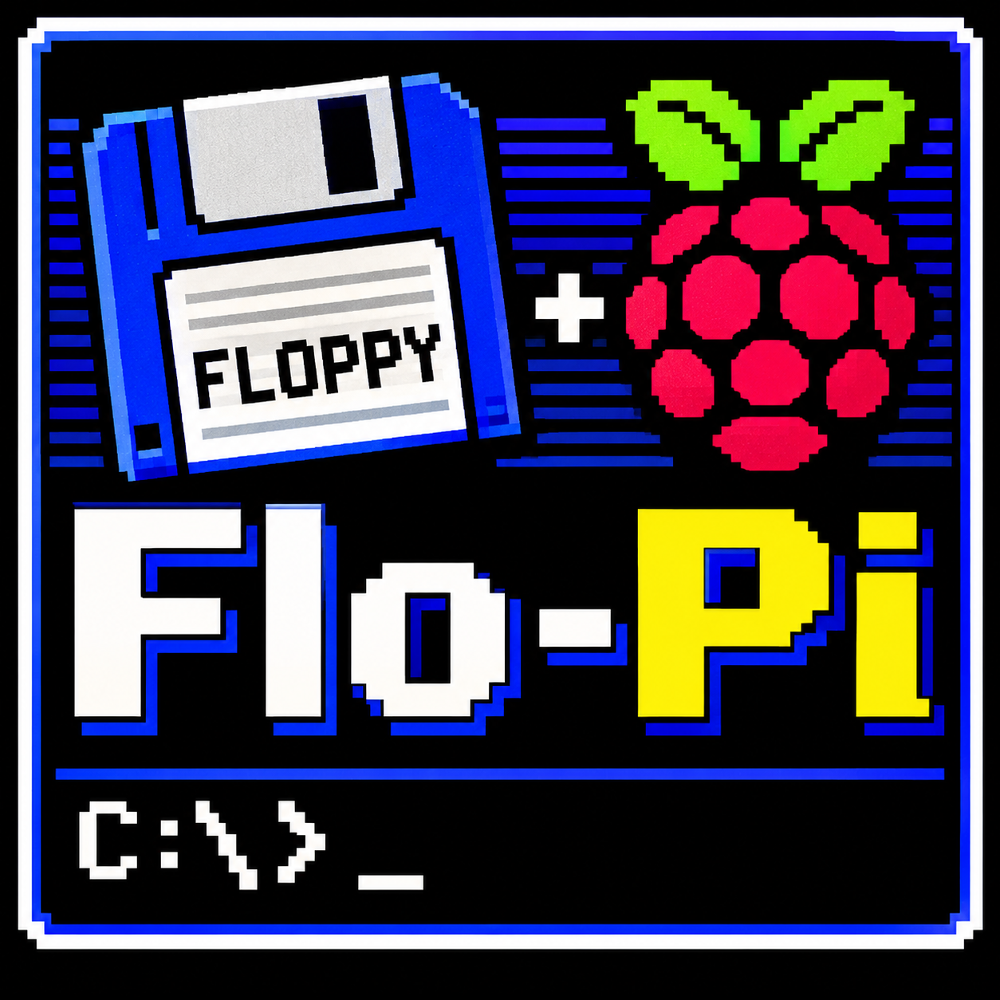

<p align="center">
  
</p>

[ESP](#español) | [EN](#english)


## Español

## Flop-Pi: ¿Qué es y cuál es su filosofía?
Flop-Pi nace de la nostalgia por recuperar la experiencia real de los primeros equipos x86: el traqueteo de las disqueteras, las limitaciones de almacenamiento y el inconfundible sonido de las tarjetas Sound Blaster.
Pero Flop-Pi no quiere limitarse a imitar aquella época. Quiere que vuelvas a vivirla.
El proyecto está diseñado para trabajar con disquetes físicos mediante una unidad USB (prepárate, porque necesitarás disquetes reales), conservando tanto sus virtudes como sus inconvenientes. Nada de atajos que eliminen la experiencia original. Todo ello aprovechando la conectividad y el reducido tamaño de equipos como Raspberry Pi, porque, seamos sinceros, el espacio no sobra.
Aquí no encontrarás facilidades innecesarias.
Si buscas un emulador moderno que te permita utilizar unidades virtuales, montar imágenes ISO o disponer de todas esas comodidades a las que estamos acostumbrados hoy en día, probablemente este no sea tu sitio.
Flop-Pi tiene otra filosofía: recuperar la experiencia de sentarse delante de un ordenador de mediados de los años 80. Eso significa volver a pelearse con el CONFIG.SYS y el AUTOEXEC.BAT, ajustar la memoria convencional, lidiar con las limitaciones del hardware y, por supuesto, esperar pacientemente a que la disquetera termine su trabajo.
Porque aquí los tiempos de carga no se simulan: se sufren y se disfrutan.
Flop-Pi no está pensado para todo el mundo. Es un proyecto para quienes disfrutaron de aquella informática, para los curiosos que quieren descubrir cómo funcionaba realmente y para los que consideran que configurar un ordenador era casi tan divertido como utilizarlo.
Si alguna vez has arrancado un ordenador desde un disquete de 3½ pulgadas, probablemente ya sabes de qué estamos hablando.

La informática de antes. Con las limitaciones de antes. Y sin pedir disculpas por ello.

Bienvenido a Flop-Pi.


---

## Requisitos: ¿Qué necesitas?

Antes de empezar, asegúrate de tener a mano lo siguiente. Aquí no hay máquinas virtuales mágicas ni disqueteras imaginarias: necesitamos hardware real.

- **Raspberry Pi:** modelos 3 Model B, 3B+, 4 o 400.

- La Raspberry Pi 3 Model B es la menos recomendable. Su procesador es el más lento de los modelos compatibles y sus 1 GB de RAM la convierten en la opción más limitada. Si buscas una experiencia lo más cercana posible a la original, es preferible utilizar una Pi 4.

- **Sistema operativo:** Raspberry Pi OS de 64 bits, recién instalado y con conexión a Internet.

- **Almacenamiento:** tarjeta microSD de 32 GB.

- **Disquetera:** unidad USB compatible (probada con NEC USB UF000x y TEAC FD-05PUB).

- **Disquetes:** por supuesto, necesitarás disquetes físicos. No hemos llegado hasta aquí para utilizar imágenes virtuales.


## Instalación: manos a la obra

Clona el repositorio y ejecuta el instalador. Él se encargará de preparar el sistema y configurar los componentes necesarios.

```bash
git clone https://github.com/Primy-games/Flop-Pi.git
cd Flop-Pi
sudo ./instalar.sh
```

El instalador utiliza automáticamente el usuario que lo ejecuta (SUDO_USER) como usuario de ejecución (RUN_USER).

Al finalizar, te preguntará si deseas reiniciar el sistema. Si prefieres hacerlo más tarde, puedes reiniciar manualmente:

```bash
sudo reboot
```

### ¿Necesitas cambiar el idioma del instalador?

Puedes forzarlo mediante la variable IDIOMA:

```bash
sudo IDIOMA=es ./instalar.sh
```

O utilizar inglés:

```bash
sudo IDIOMA=en ./instalar.sh
```

## Uso: bienvenido de nuevo a los años 80

Una vez instalado y reiniciado el sistema, Flop-Pi arrancará automáticamente.

Estas son algunas de las operaciones básicas:

- **Disquetes:** conecta la disquetera USB con un disco insertado. Flop-Pi lo reconocerá automáticamente como unidad A:. Cuando cambies de disco, el sistema detectará el nuevo sin necesidad de reiniciar.
- **Ratón:** queda capturado al hacer clic dentro de la ventana.
- **Pantalla completa:** se activa automáticamente.
- **Apagado:** escribe `SHUTDOWN` dentro de FreeDOS. Al cerrarse QEMU, la Raspberry Pi se apagará automáticamente por defecto.

**IMPORTANTE:** no desconectes la alimentación de la Raspberry Pi mientras FreeDOS esté funcionando. Utiliza siempre el comando `SHUTDOWN` para apagar correctamente el sistema.

## Estructura del proyecto

Esta es la organización de los archivos del repositorio:

```text
freedos-kiosk/
├── instalar.sh                  Instalador (bilingüe)
├── README.md                    Documentación del proyecto
├── src/
│   ├── freedos-kiosk.sh         Lanzamiento de QEMU, volúmenes,
│   │                            salida HDMI y vigilancia de disquetes
│   ├── freedos-kiosk-xinitrc    Sesión X: vídeo de introducción
│   │                            y lanzamiento del sistema
│   ├── freedos-kiosk.service    Servicio de systemd
│   └── 90-floppy-usb.rules      Regla udev para /dev/floppy-usb
├── media/
│   └── intro.mp4                Vídeo de introducción (opcional)
└── image/
    ├── freedos14full.img.xz     Imagen comprimida de FreeDOS
    └── SHA256SUMS               Suma de verificación de la imagen
```

## ¿Qué instala y qué modifica?

Flop-Pi necesita preparar algunos componentes del sistema operativo para ofrecer una experiencia de arranque directa, sin escritorios ni elementos innecesarios.

### Paquetes instalados

- qemu-system-x86
- qemu-system-gui
- socat
- xinit
- openbox
- x11-xserver-utils
- unclutter
- mpv
- pulseaudio-utils
- xz-utils

### Archivos del sistema

El instalador crea o modifica los siguientes archivos y directorios:

- `/usr/local/bin/freedos-kiosk.sh`
- `/usr/local/bin/freedos-kiosk-xinitrc`
- `/etc/systemd/system/freedos-kiosk.service`
- `/etc/udev/rules.d/90-floppy-usb.rules`
- `/var/lib/freedos-kiosk/` (imagen del sistema y vídeo)
- `/boot/firmware/cmdline.txt` (se conserva una copia de seguridad en `cmdline.txt.bak`)
- `/boot/firmware/config.txt` (añade `disable_splash=1` dentro de `[all]` para eliminar la pantalla del arcoíris durante el arranque).

### Modificaciones del sistema

Para conseguir un arranque directo, el instalador realiza los siguientes cambios:

- Enmascara `getty@tty1`, eliminando el inicio de sesión en la terminal principal.
- Cambia el destino de arranque predeterminado a `multi-user.target` y desactiva `lightdm`.
- Desactiva `cloud-init` y `NetworkManager-wait-online` para acelerar el arranque, sin desactivar la conectividad de red.
- Elimina el asistente de bienvenida (`piwiz.desktop`).
- Activa `loginctl enable-linger` para el usuario de ejecución, permitiendo que PipeWire esté disponible durante el arranque.

## Personalización: cada máquina es un mundo

Aunque Flop-Pi viene preparado para funcionar directamente, puedes modificar algunos parámetros para adaptar la experiencia a tu hardware.

### Memoria, CPU y dispositivos

En el mismo archivo encontrarás la línea de ejecución de `qemu-system-i386`.

Allí puedes modificar los parámetros de memoria (`-m`), procesador (`-cpu`), aceleración (`-accel`) y dispositivos (`-device`).

### Salida de audio HDMI

El script busca automáticamente la salida HDMI de PipeWire durante el arranque y la establece como predeterminada cuando está disponible.

Si prefieres utilizar otra salida, como el conector jack de 3,5 mm, puedes modificar la línea `pactl set-default-sink` o establecer manualmente la salida mediante:

```bash
wpctl set-default
```

### Vídeo de introducción

Puedes sustituir `media/intro.mp4` por otro vídeo antes de instalar el sistema.

Si prefieres arrancar directamente sin introducción, simplemente elimina ese archivo.

### Apagado automático

Por defecto, la Raspberry Pi se apaga al cerrar QEMU.

En `src/freedos-kiosk.sh`, localiza:

```bash
POWEROFF_AL_SALIR=1
```

Cambia el valor a `0` si prefieres que la Raspberry Pi permanezca encendida después de salir de QEMU.

## Overclock (opcional)

El instalador no modifica las frecuencias de funcionamiento de la CPU.

Si quieres experimentar con un pequeño overclock, puedes añadir manualmente la siguiente configuración en /boot/firmware/config.txt, dentro de la sección [all]:

```ini
arm_freq=1300
```

Ten en cuenta lo siguiente:

- Los valores admitidos dependen del modelo de Raspberry Pi y de la alimentación utilizada.
- La Raspberry Pi 3 Model B funciona de fábrica a 1,2 GHz.
- Antes de experimentar con frecuencias superiores, comprueba que la alimentación es estable ejecutando:

  ```bash
  vcgencmd get_throttled
  ```

El resultado esperado es `0x0`. Cualquier otro valor puede indicar problemas de alimentación, limitación térmica u otros eventos de *throttling*.

Si la Raspberry Pi deja de arrancar después de modificar las frecuencias, puedes retirar la configuración desde otro ordenador, conectando la tarjeta microSD y editando `config.txt`.

## Utilizar otra imagen de sistema

La imagen de FreeDOS utilizada por Flop-Pi se encuentra en:

```text
/var/lib/freedos-kiosk/freedos14full.img
```

Si quieres experimentar con otro sistema operativo compatible con x86, puedes sustituirla por tu propia imagen.

### Procedimiento

1. Crea un disco virtual de 16 GB:

   ```bash
   qemu-img create -f raw mi_disco.img 16G
   ```

2. Instala el sistema operativo que quieras utilizando la imagen de instalación correspondiente, arrancando desde ella mediante `-fda` o `-cdrom`.

3. Copia el resultado a `/var/lib/freedos-kiosk/freedos14full.img` o modifica la ruta de la imagen en `freedos-kiosk.sh`.

4. Reinicia el servicio:

   ```bash
   sudo systemctl restart freedos-kiosk.service
   ```

En principio, cualquier sistema operativo compatible con PC x86 que pueda arrancar mediante QEMU debería funcionar. No obstante, puede ser necesario modificar los parámetros de CPU, memoria y dispositivos virtuales.

## Solución de problemas

Porque, seamos sinceros, estamos recreando una época en la que las cosas no siempre funcionaban a la primera.

Estos son algunos de los problemas más habituales y cómo diagnosticarlos.

| Problema | Solución |
|---|---|
| QEMU no arranca | Consulta los registros con `journalctl -u freedos-kiosk -b --no-pager \| tail -n 40`. |
| La disquetera no aparece | Comprueba `/dev/floppy-usb` con `ls -l /dev/floppy-usb`. Desconecta la unidad, espera unos segundos y vuelve a conectarla. |
| Aparecen mensajes de Linux en pantalla | Comprueba que `/boot/firmware/cmdline.txt` contiene `systemd.show_status=0 fbcon=map:9`. |
| Aviso de JemmEx sobre E400-EBFF | Es un aviso conocido, no un error de funcionamiento. |
| No hay sonido | Ejecuta `SBMIX` dentro de FreeDOS para comprobar que el mezclador no está silenciado. En Raspberry Pi, utiliza `wpctl status` para comprobar la salida activa. |
| El altavoz interno suena distorsionado | Reduce el volumen del nodo `snd1` en el script. |
| La Raspberry Pi reduce su rendimiento o se reinicia | Comprueba la alimentación y la temperatura mediante `vcgencmd get_throttled`. |

## Desinstalación

Si decides retirar Flop-Pi de tu Raspberry Pi, puedes ejecutar los siguientes comandos:

```bash
sudo systemctl disable --now freedos-kiosk.service
sudo rm /etc/systemd/system/freedos-kiosk.service /usr/local/bin/freedos-kiosk*.sh /usr/local/bin/freedos-kiosk-xinitrc /etc/udev/rules.d/90-floppy-usb.rules
sudo systemctl unmask getty@tty1.service
sudo cp /boot/firmware/cmdline.txt.bak /boot/firmware/cmdline.txt
sudo rm -rf /var/lib/freedos-kiosk
sudo reboot
```

Tenga en cuenta que este procedimiento elimina los archivos de Flop-Pi y restaura cmdline.txt, pero no revierte automáticamente todos los cambios realizados durante la instalación.

## Limitaciones conocidas

No vamos a venderte humo. La Raspberry Pi tiene sus limitaciones y la emulación de hardware x86 tiene un coste de rendimiento.

- **Rendimiento:** la emulación sin aceleración por hardware puede resultar lenta, especialmente en Raspberry Pi 3. Algunos juegos y aplicaciones exigirán más recursos de los disponibles.
- **Procesamiento:** parámetros como `thread=multi` o `tb-size` no proporcionan mejoras de rendimiento medibles en Raspberry Pi 3 con una única CPU emulada.
- **Software comercial:** los juegos y programas comerciales no se incluyen. Tendrás que incorporarlos tú mismo a la imagen.
- **Audio:** el altavoz interno del PC y la tarjeta de sonido comparten la salida de audio, aunque sus volúmenes se pueden ajustar independientemente mediante PipeWire.
- **HDMI:** la disponibilidad de la salida de audio HDMI depende del monitor o televisor conectado.

Recuerda: Flop-Pi no pretende convertir una Raspberry Pi en un PC moderno. Pretende acercarte a la experiencia de utilizar uno de aquellos ordenadores, con sus limitaciones y peculiaridades.

Y eso incluye aceptar que, algunas veces, tendrás que esperar.

---

---

## English

## Flop-Pi: What Is It and What Is Its Philosophy?

Flop-Pi was born out of nostalgia for bringing back the authentic experience of the early x86 computers: the clatter of floppy disk drives, storage limitations, and the unmistakable sound of Sound Blaster cards.

But Flop-Pi doesn't just want to imitate that era. It wants you to experience it all over again.

The project is designed to work with physical floppy disks through a USB drive (get ready, because you'll need actual floppy disks), preserving both their advantages and their drawbacks. No shortcuts that take away from the original experience. All this while taking advantage of the connectivity and compact size of devices like the Raspberry Pi, because let's face it, space is at a premium.

You won't find any unnecessary conveniences here.

If you're looking for a modern emulator that lets you use virtual drives, mount ISO images, or enjoy all the conveniences we've grown accustomed to nowadays, this probably isn't the place for you.

Flop-Pi follows a different philosophy: bringing back the experience of sitting in front of a computer from the mid-1980s. That means wrestling with CONFIG.SYS and AUTOEXEC.BAT again, tweaking conventional memory, dealing with hardware limitations and, of course, patiently waiting for the floppy drive to finish doing its job.

Because here, loading times aren't simulated: they're endured and enjoyed.

Flop-Pi isn't for everyone. It's a project for those who enjoyed computing back then, for curious minds who want to discover how things really worked, and for those who believe that configuring a computer was almost as much fun as actually using it.

If you've ever booted a computer from a 3½-inch floppy disk, you probably know exactly what we're talking about.

Computing the way it used to be. With the limitations it used to have. And without apologizing for any of it.

Welcome to Flop-Pi.

---

## Requirements: What do you need?

Before getting started, make sure you have the following hardware ready. There are no magic virtual machines or imaginary floppy drives here: we need real hardware.

- **Raspberry Pi:** Models 3 Model B, 3B+, 4 or 400.
- The Raspberry Pi 3 Model B is the least recommended option. It has the slowest processor among the supported models, and its 1 GB of RAM makes it the most limited choice. If you're looking for an experience as close as possible to the original, a Pi 4 is preferable.
- **Operating system:** A fresh installation of 64-bit Raspberry Pi OS with an Internet connection.
- **Storage:** 32 GB microSD card.
- **Floppy drive:** Compatible USB floppy drive (tested with NEC USB UF000x and TEAC FD-05PUB).
- **Floppy disks:** Of course, you'll need actual physical floppy disks. We haven't come this far just to use virtual disk images.

## Installation: Let's get started

Clone the repository and run the installer. It will take care of preparing the system and configuring the required components.

```bash
git clone https://github.com/Primy-games/Flop-Pi.git
cd Flop-Pi
sudo ./instalar.sh
```

The installer automatically uses the user who launched it (`SUDO_USER`) as the runtime user (`RUN_USER`).

At the end, it will ask whether you want to reboot the system. If you prefer to do it later, you can reboot manually:

```bash
sudo reboot
```

### Need to change the installer's language?

You can force the language using the `IDIOMA` variable:

```bash
sudo IDIOMA=es ./instalar.sh
```

Or select English:

```bash
sudo IDIOMA=en ./instalar.sh
```

## Usage: Welcome back to the 1980s

Once installed and rebooted, Flop-Pi will start automatically.

Here are some basic operations:

- **Floppy disks:** Connect the USB floppy drive with a disk inserted. Flop-Pi will automatically detect it as drive A:. When you swap disks, the system will detect the new one without requiring a reboot.
- **Mouse:** The mouse is captured when you click inside the window.
- **Fullscreen:** Enabled automatically.
- **Shutdown:** Type `SHUTDOWN` inside FreeDOS. When QEMU closes, the Raspberry Pi will automatically shut down by default.

**IMPORTANT:** Never disconnect the Raspberry Pi's power supply while FreeDOS is running. Always use the `SHUTDOWN` command to shut down the system properly.

## Project structure

This is how the repository files are organized:

```text
freedos-kiosk/
├── instalar.sh                  Installer (bilingual)
├── README.md                    Project documentation
├── src/
│   ├── freedos-kiosk.sh         QEMU launcher, audio levels,
│   │                            HDMI output and floppy disk monitoring
│   ├── freedos-kiosk-xinitrc    X session: intro video
│   │                            and system launch
│   ├── freedos-kiosk.service    systemd service
│   └── 90-floppy-usb.rules      udev rule for /dev/floppy-usb
├── media/
│   └── intro.mp4                Intro video (optional)
└── image/
    ├── freedos14full.img.xz     Compressed FreeDOS image
    └── SHA256SUMS               Image checksum
```

## What does it install and modify?

Flop-Pi needs to prepare certain operating system components to provide a direct boot experience, without desktops or unnecessary elements.

### Installed packages

- qemu-system-x86
- qemu-system-gui
- socat
- xinit
- openbox
- x11-xserver-utils
- unclutter
- mpv
- pulseaudio-utils
- xz-utils

### System files

The installer creates or modifies the following files and directories:

- `/usr/local/bin/freedos-kiosk.sh`
- `/usr/local/bin/freedos-kiosk-xinitrc`
- `/etc/systemd/system/freedos-kiosk.service`
- `/etc/udev/rules.d/90-floppy-usb.rules`
- `/var/lib/freedos-kiosk/` (system image and video)
- `/boot/firmware/cmdline.txt` (a backup is saved as `cmdline.txt.bak`)
- `/boot/firmware/config.txt` (adds `disable_splash=1` inside `[all]` to hide the rainbow splash screen during boot).

### System modifications

To achieve direct boot, the installer makes the following changes:

- Masks `getty@tty1`, removing the login prompt from the main terminal.
- Changes the default boot target to `multi-user.target` and disables `lightdm`.
- Disables `cloud-init` and `NetworkManager-wait-online` to speed up boot without disabling network connectivity.
- Removes the welcome wizard (`piwiz.desktop`).
- Enables `loginctl enable-linger` for the runtime user, allowing PipeWire to be available during startup.

## Customization: Every machine is different

Although Flop-Pi comes ready to run, you can modify several settings to adapt the experience to your hardware.

### Memory, CPU and devices

In the same file, you'll find the `qemu-system-i386` launch command.

There you can modify the memory (`-m`), processor (`-cpu`), acceleration (`-accel`) and device (`-device`) parameters.

### HDMI audio output

The script automatically searches for the HDMI audio output in PipeWire during startup and sets it as the default whenever available.

If you prefer to use another output, such as the 3.5 mm audio jack, you can modify the `pactl set-default-sink` line or manually set the output using:

```bash
wpctl set-default
```

### Intro video

You can replace `media/intro.mp4` with another video before installing the system.

If you prefer to boot directly without an intro, simply remove that file.

### Automatic shutdown

By default, the Raspberry Pi shuts down when QEMU closes.

In `src/freedos-kiosk.sh`, locate:

```bash
POWEROFF_AL_SALIR=1
```

Change the value to `0` if you prefer the Raspberry Pi to remain powered on after exiting QEMU.

## Overclocking (optional)

The installer does not modify the CPU operating frequencies.

If you want to experiment with a modest overclock, you can manually add the following setting to `/boot/firmware/config.txt`, inside the `[all]` section:

```ini
arm_freq=1300
```

Please keep the following in mind:

- Supported values depend on the Raspberry Pi model and the power supply being used.
- The Raspberry Pi 3 Model B runs at 1.2 GHz by default.
- Before experimenting with higher frequencies, check that the power supply is stable before running the installer:

```bash
vcgencmd get_throttled
```

The expected result is `0x0`. Any other value may indicate power supply issues, thermal throttling or other throttling events.

If your Raspberry Pi fails to boot after changing the frequencies, you can remove the configuration from another computer by connecting the microSD card and editing `config.txt`.

## Using a different system image

The FreeDOS image used by Flop-Pi is located at:

```text
/var/lib/freedos-kiosk/freedos14full.img
```

If you want to experiment with another x86-compatible operating system, you can replace it with your own image.

### Procedure

1. Create a 16 GB virtual disk:

   ```bash
   qemu-img create -f raw my_disk.img 16G
   ```

2. Install your chosen operating system using its installation image, booting from it through `-fda` or `-cdrom`.

3. Copy the resulting image to `/var/lib/freedos-kiosk/freedos14full.img` or change the image path in `freedos-kiosk.sh`.

4. Restart the service:

   ```bash
   sudo systemctl restart freedos-kiosk.service
   ```

In principle, any x86-compatible PC operating system that can boot under QEMU should work. However, you may need to adjust the CPU, memory and virtual device parameters.

## Troubleshooting

Let's face it: we're recreating an era when things didn't always work on the first try.

Here are some of the most common problems and how to diagnose them.

| Problem | Solution |
|---|---|
| QEMU won't start | Check the logs using `journalctl -u freedos-kiosk -b --no-pager \| tail -n 40`. |
| The floppy drive is not detected | Check `/dev/floppy-usb` using `ls -l /dev/floppy-usb`. Disconnect the drive, wait a few seconds and reconnect it. |
| Linux messages appear on screen | Check that `/boot/firmware/cmdline.txt` contains `systemd.show_status=0 fbcon=map:9`. |
| JemmEx warning about E400-EBFF | This is a known warning, not a functional error. |
| No sound | Run `SBMIX` inside FreeDOS to check that the mixer isn't muted. On the Raspberry Pi, use `wpctl status` to check the active audio output. |
| The internal speaker sounds distorted | Reduce the volume of the `snd1` node in the script. |
| The Raspberry Pi throttles or reboots unexpectedly | Check the power supply and temperature using `vcgencmd get_throttled`. |

## Uninstallation

If you decide to remove Flop-Pi from your Raspberry Pi, you can run the following commands:

```bash
sudo systemctl disable --now freedos-kiosk.service
sudo rm /etc/systemd/system/freedos-kiosk.service /usr/local/bin/freedos-kiosk*.sh /usr/local/bin/freedos-kiosk-xinitrc /etc/udev/rules.d/90-floppy-usb.rules
sudo systemctl unmask getty@tty1.service
sudo cp /boot/firmware/cmdline.txt.bak /boot/firmware/cmdline.txt
sudo rm -rf /var/lib/freedos-kiosk
sudo reboot
```

Please note that this procedure removes Flop-Pi files and restores `cmdline.txt`, but does not automatically revert all the changes made during installation.

## Known limitations

We're not going to sugarcoat it. The Raspberry Pi has its limitations, and emulating x86 hardware comes at a performance cost.

- **Performance:** Emulation without hardware acceleration can be slow, especially on the Raspberry Pi 3. Some games and applications may demand more resources than the hardware can provide.
- **Processing:** Parameters such as `thread=multi` or `tb-size` do not provide measurable performance improvements on the Raspberry Pi 3 with a single emulated CPU.
- **Commercial software:** Commercial games and programs are not included. You'll need to add them to the image yourself.
- **Audio:** The PC's internal speaker and sound card share the same audio output, although their volumes can be adjusted independently through PipeWire.
- **HDMI:** HDMI audio availability depends on the connected monitor or TV.

**Remember:** Flop-Pi is not intended to turn a Raspberry Pi into a modern PC. Its purpose is to bring you closer to the experience of using one of those old computers, complete with their limitations and quirks.

And that means accepting that sometimes, you'll just have to wait.
---
